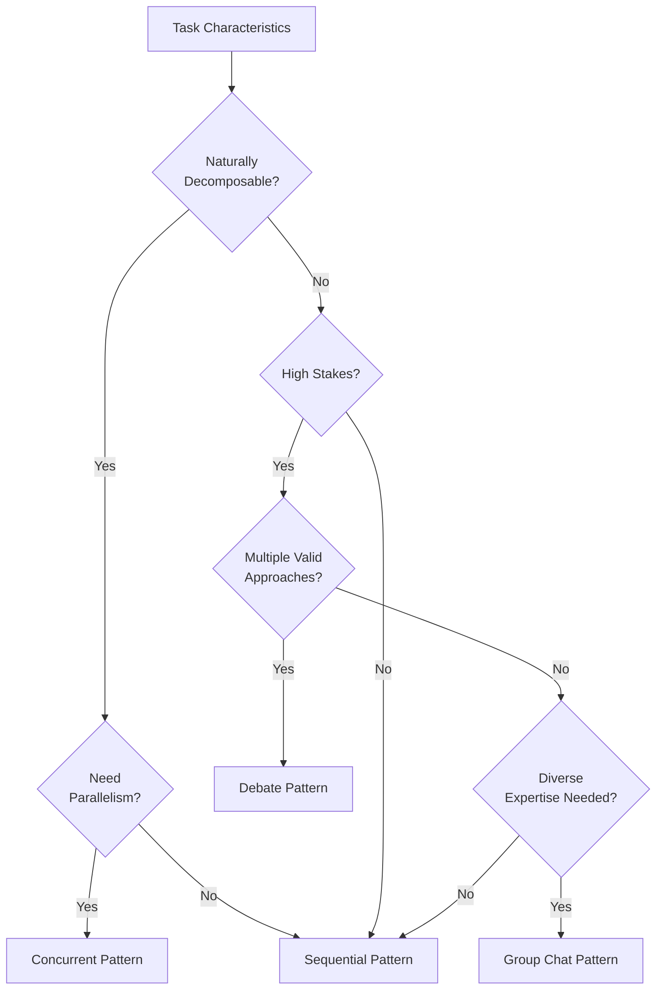

# Literature Review: LLM Agent Architectures for Autonomous Systems

> **Purpose**: This comprehensive literature review provides foundational knowledge for the multi-agent study outlined in `AGENT_ARCHITECTURE_STUDY.md`. It synthesizes current research on agent architectures, design patterns, strengths, weaknesses, and applicability to network configuration tasks.

**Date**: January 2026  
**Context**: Supporting Paper 2 — Single-Agent vs Multi-Agent Architectures for Network Management

---

## Table of Contents

1. [Introduction](#1-introduction)
2. [Fundamental Agent Architecture Components](#2-fundamental-agent-architecture-components)
3. [Single-Agent Architectures](#3-single-agent-architectures)
4. [Multi-Agent System Architectures](#4-multi-agent-system-architectures)
5. [Multi-Agent Design Patterns](#5-multi-agent-design-patterns)
6. [Communication and Coordination Protocols](#6-communication-and-coordination-protocols)
7. [Memory Architectures](#7-memory-architectures)
8. [Empirical Comparisons: Single vs Multi-Agent](#8-empirical-comparisons-single-vs-multi-agent)
9. [Application to Network Automation](#9-application-to-network-automation)
10. [Validation of dagent Design Assumptions](#10-validation-of-dagent-design-assumptions)
11. [Research Gaps and Future Directions](#11-research-gaps-and-future-directions)
12. [References and Key Sources](#12-references-and-key-sources)

---

## 1. Introduction

The emergence of Large Language Models (LLMs) as the cognitive backbone of autonomous agents has sparked intensive research into optimal architectural patterns for AI systems. As LLMs have demonstrated remarkable capabilities in reasoning, planning, and tool use, the fundamental question has shifted from "Can LLMs solve problems?" to "How should we structure LLM-based systems for maximum effectiveness?"

This literature review addresses the core research question posed in Paper 2:

> **Which agent architectures are effective for complex network configuration tasks?**

The review synthesizes findings from 2024-2025 research on:
- Single-agent vs multi-agent architectures
- Design patterns for agent orchestration
- Role specialization and task decomposition strategies
- Communication protocols and coordination mechanisms
- Memory architectures for stateful agents
- Empirical performance comparisons

---

## 2. Fundamental Agent Architecture Components

### 2.1 Core Agent Components

Modern LLM agent architectures consistently incorporate four fundamental components (Medium, 2024; AnalyticsVidhya, 2024):

| Component | Description | Implementation Examples |
|-----------|-------------|------------------------|
| **Agent Core (Brain)** | Central reasoning and decision-making | LLM with system prompt, ReAct loop |
| **Memory Module** | Information retention across interactions | Short-term (context), Long-term (vector DB) |
| **Tools** | External environment interaction | API calls, code execution, file operations |
| **Planning Module** | Task decomposition and sequencing | Chain-of-Thought, Tree of Thoughts |

### 2.2 Agentic Design Patterns

Andrew Ng (DeepLearning.AI, 2024) identified four key "agentic design patterns" that represent strategies for making LLMs more autonomous:

1. **Reflection**: LLM evaluates and refines its own output through self-critique
2. **Tool Use**: LLM equipped with external tools (web search, code execution, APIs)
3. **Planning**: Complex task decomposition into smaller, manageable components
4. **Multi-Agent Collaboration**: Multiple AI agents working together, splitting tasks and engaging in discussions

These patterns are not mutually exclusive; production systems often combine multiple patterns to achieve robust performance.

---

## 3. Single-Agent Architectures

### 3.1 Monolithic LLM Agents

The simplest agent architecture employs a single LLM with access to all tools and context. This "generalist" approach is characterized by:

**Structure**:
```
User Query → System Prompt + Tools → LLM → Tool Calls → Environment → Observation → LLM → Response
```

**Strengths**:
- **Simplicity**: Minimal orchestration overhead, easier to debug and maintain
- **Coherent Context**: All reasoning happens within a single context window
- **Lower Latency**: No inter-agent communication delays
- **Cost Efficiency**: Single LLM inference per step (at least theoretically)

**Weaknesses**:
- **Context Limitations**: Single context window constrains available information
- **No Perspective Diversity**: Single viewpoint may miss alternative approaches
- **Scalability Issues**: Struggles with highly complex, multi-faceted tasks
- **Specialization Gap**: Cannot leverage domain-specific expertise

### 3.2 ReAct (Reasoning + Acting) Framework

ReAct (Yao et al., 2022) represents a significant advancement in single-agent reasoning, enabling LLMs to perform more complex, human-like problem-solving through an iterative "thought-action-observation" loop:

```
Thought → Action → Observation → Thought → Action → Observation → ... → Final Answer
```

**Key Characteristics**:
- **Interleaved Reasoning**: Thoughts and actions alternate, allowing dynamic plan adjustment
- **Tool Integration**: Actions involve external tool calls for information gathering or state modification
- **Interpretability**: Explicit reasoning traces expose agent decision-making process
- **Error Recovery**: Observations can trigger plan revision

**Empirical Performance**:
ReAct has been shown to outperform traditional Chain-of-Thought prompting, particularly in reducing factual hallucinations. It yields optimal results when combined with CoT and self-consistency checks (PrompingGuide.ai, 2024).

### 3.3 Chain-of-Thought (CoT) Reasoning

CoT prompting (Wei et al., 2022) guides LLMs to articulate reasoning in discrete steps:

**Mechanism**:
- Problem decomposed into logical sub-problems
- Each step builds on previous reasoning
- Final answer derived from accumulated reasoning

**Limitations**:
- Linear reasoning path: no exploration of alternatives
- No backtracking capability
- Cannot recover from early-stage errors

### 3.4 Tree of Thoughts (ToT)

ToT (Yao et al., 2024) extends CoT by enabling tree-based exploration of reasoning paths:

**Architecture Components**:
1. **Prompter Agent**: Crafts prompts for incremental reasoning
2. **Checker Module**: Evaluates logical correctness of intermediate thoughts
3. **Memory Module**: Maintains full state tree with solutions and outcomes

**Advantages over Linear Reasoning**:
- Explores multiple reasoning possibilities in parallel
- Evaluates intermediate outcomes before committing
- Can backtrack from less promising paths
- Inspired by human trial-and-error reasoning

**Use Cases**: Planning tasks, combinatorial search, problems requiring recovery from intermediate errors.

---

## 4. Multi-Agent System Architectures

### 4.1 Rationale for Multi-Agent Systems

Multi-agent LLM systems (LLM-MAS) have emerged as a solution to limitations inherent in single-agent approaches. Research from 2024-2025 highlights several motivations:

**Modularity and Separation of Concerns**:
- Different agents can specialize in different aspects of a problem
- Clear boundaries enable independent development and testing
- Easier to scale by adding specialized agents

**Enhanced Accuracy and Reliability**:
- Agents can cross-check each other's work
- Diverse perspectives reduce bias and blind spots
- Error detection through collaborative verification

**Extended Context Handling**:
- Multi-agent systems can handle information exceeding single context windows
- Task distribution across agents enables parallel context utilization

**Human-In-The-Loop (HITL) Facilitation**:
- Clear agent roles make it easier for humans to intervene at specific points
- Structured workflows support approval gates

### 4.2 Hierarchical Architectures

Hierarchical multi-agent systems organize agents in layers, mirroring organizational structures:

```
                    ┌─────────────────┐
                    │  Top Supervisor │
                    └────────┬────────┘
             ┌───────────────┼───────────────┐
             ▼               ▼               ▼
      ┌──────────┐    ┌──────────┐    ┌──────────┐
      │ Team Lead│    │ Team Lead│    │ Team Lead│
      └────┬─────┘    └────┬─────┘    └────┬─────┘
           │               │               │
     ┌─────┼─────┐   ┌─────┼─────┐   ┌─────┼─────┐
     ▼     ▼     ▼   ▼     ▼     ▼   ▼     ▼     ▼
   Agent Agent Agent Agent Agent Agent Agent Agent Agent
```

**Characteristics** (LangGraph documentation, 2024):
- Top-level supervisor manages specialized teams
- Mid-level supervisors coordinate sub-agents within teams
- Clear communication channels and delegation protocols
- Scalable: can add agents or teams as complexity grows

**Benefits**:
- **Scalability**: Breaks down complex problems into manageable sub-tasks
- **Efficiency**: Better resource allocation through specialization
- **Robust State Management**: Graph-based approach allows conditional control flows

**Frameworks**: LangGraph's `langgraph-supervisor` library, LangChain hierarchical patterns.

### 4.3 Flat Multi-Agent Architectures

In contrast to hierarchical systems, flat architectures feature peer agents with equal status:

**Characteristics**:
- No central controller; agents communicate directly
- Emergent coordination through defined protocols
- Often used in debate and discussion patterns

**Challenges**:
- Risk of inconsistent reasoning across agents
- Potential for duplicated efforts
- Coordination overhead increases with agent count

### 4.4 Blackboard Architecture

The blackboard architecture (revitalized for LLM-MAS) uses a shared data repository for agent coordination:

**Components**:
1. **Blackboard**: Central, dynamic shared memory accessible by all agents
2. **Knowledge Sources (Agents)**: Specialized LLM agents that read from and write to blackboard
3. **Control Unit**: Manages problem-solving process, selects next agent to act

**Advantages**:
- Dynamic collaboration and incremental problem-solving
- Reduced token costs by centralizing shared information
- Well-suited for ill-structured problems (scientific discovery, medical diagnosis)

---

## 5. Multi-Agent Design Patterns

This section examines specific orchestration patterns, with direct relevance to the dagent patterns under evaluation.

### 5.1 Sequential Pattern (Planner → Executor → Verifier)

**Description**: Agents operate in a deterministic sequence, each performing a specific phase of the task.

**Literature Support** (AutoGen, 2024):
- Microsoft AutoGen's "Sequential Chat" pattern chains agent conversations
- "Carryover mechanism" transfers context between phases
- Each agent builds upon previous agent's output

**Typical Structure**:
```
┌────────────┐     ┌────────────┐     ┌────────────┐
│  Planner   │ ──► │  Executor  │ ──► │  Verifier  │
│ (Strategy) │     │ (Actions)  │     │ (Validate) │
└────────────┘     └────────────┘     └────────────┘
```

**Strengths**:
- Clear phase separation enables focused prompts
- Planner can create high-quality plans without tool execution concerns
- Verifier provides independent quality assurance
- Natural fit for tasks with distinct planning/execution phases

**Weaknesses**:
- Limited parallelism (inherently serial)
- Context must be explicitly passed between phases
- Error in early phase propagates through entire pipeline
- May be slower for tasks that don't require explicit planning

**Best Use Cases**:
- Complex tasks requiring deliberate planning before action
- High-stakes scenarios benefiting from verification
- Tasks with clear problem → plan → execute → validate structure

**Relevance to dagent**: The `SequentialPattern` implementation in dagent aligns with this established pattern, using separate Planner, Executor, and Verifier agents.

---

### 5.2 Concurrent Pattern (Fan-Out/Aggregate)

**Description**: A single task is split into independent subtasks, processed in parallel, and results are aggregated.

**Literature Support** (Anthropic, 2024; K2View, 2024):
- "Orchestrator" agent decomposes task and spawns subagents
- Multiple workers execute subtasks simultaneously
- "Aggregator" synthesizes individual results into coherent output

**Typical Structure**:
```
                    ┌────────────┐
                    │  Splitter  │
                    └─────┬──────┘
           ┌──────────────┼──────────────┐
           ▼              ▼              ▼
      ┌─────────┐    ┌─────────┐    ┌─────────┐
      │ Worker 1│    │ Worker 2│    │ Worker 3│
      └────┬────┘    └────┬────┘    └────┬────┘
           └──────────────┼──────────────┘
                          ▼
                   ┌────────────┐
                   │ Aggregator │
                   └────────────┘
```

**Strengths**:
- **Significant speedup**: Parallel execution reduces wall-clock time
- **Scalability**: Add workers to increase throughput
- **Fault tolerance**: Failure in one worker doesn't block others
- **Specialization**: Workers can focus on specific subtasks

**Weaknesses**:
- Requires naturally decomposable tasks
- Aggregation can be challenging for interdependent subtasks
- Increased complexity in coordination and error handling
- Overhead of task splitting and result merging

**Best Use Cases**:
- Large-scale tasks with independent components
- Network configurations across multiple independent segments
- Research tasks requiring diverse perspectives
- Embarrassingly parallel problems

**Relevance to dagent**: The `ConcurrentPattern` in dagent implements this pattern with Splitter, Workers, and Aggregator agents. This is particularly relevant for RQ3 (parallelism and scaling).

---

### 5.3 Debate Pattern (Adversarial Reasoning)

**Description**: Multiple agents argue different perspectives through iterative refinement, with a judge evaluating and selecting the best approach.

**Literature Support** (AutoGen debate pattern; IJCSMA, 2024):
- "Solver" agents propose and defend solutions
- Multiple rounds of debate and critique
- "Aggregator" or "Judge" agent evaluates arguments and selects best approach

**Typical Structure**:
```
┌────────────┐      ┌────────────┐
│ Proponent  │ ◄──► │  Opponent  │    (Multiple Rounds)
│ (Propose)  │      │ (Critique) │
└─────┬──────┘      └──────┬─────┘
      └───────────┬────────┘
                  ▼
           ┌────────────┐
           │    Judge   │
           │ (Evaluate) │
           └─────┬──────┘
                 ▼
           ┌────────────┐
           │  Executor  │
           │(Implement) │
           └────────────┘
```

**Strengths**:
- **Enhanced reasoning quality**: Adversarial critique catches errors
- **Reduced hallucinations**: Claims are challenged and verified
- **Diverse perspectives**: Proponent and opponent represent different viewpoints
- **Self-correction**: Iterative refinement leads to robust solutions

**Weaknesses**:
- **Higher latency**: Multiple debate rounds increase time
- **Token intensive**: Extensive back-and-forth increases costs
- **Convergence not guaranteed**: Debates may not reach consensus
- **Overhead for simple tasks**: Unnecessary for straightforward problems

**Best Use Cases**:
- High-stakes decisions requiring thorough vetting
- Tasks where correctness is critical
- Complex reasoning tasks with multiple valid approaches
- Scenarios where reducing hallucinations is paramount

**Empirical Evidence** (GitHub.io, 2024):
Multi-agent debate significantly improves:
- Mathematical reasoning accuracy
- Factual validity of generated content
- Strategic planning quality

**Relevance to dagent**: The `DebatePattern` implementation aligns with this established approach, using Proponent, Opponent, Judge, and Executor agents.

---

### 5.4 Group Chat Pattern (Manager-Coordinated Discussion)

**Description**: Multiple specialized agents participate in a discussion coordinated by a manager agent who selects the next speaker.

**Literature Support** (AutoGen Group Chat; CrewAI, 2024):
- Manager agent orchestrates conversation flow
- Specialized participants contribute based on their expertise
- Discussion continues until task completion or consensus

**Typical Structure**:
```
                    ┌─────────────┐
                    │   Manager   │
                    │ (Moderator) │
                    └──────┬──────┘
                           │ (selects next speaker)
        ┌──────────────────┼──────────────────┐
        ▼                  ▼                  ▼
  ┌───────────┐      ┌───────────┐      ┌───────────┐
  │ Planner   │      │ Executor  │      │ Reviewer  │
  │ Agent     │      │ Agent     │      │ Agent     │
  └───────────┘      └───────────┘      └───────────┘
```

**Strengths**:
- **Flexible coordination**: Manager dynamically selects best agent for each step
- **Specialization**: Participants focus on their domain expertise
- **Emergent workflows**: Discussion flow adapts to task requirements
- **Natural collaboration**: Mimics human team discussions

**Weaknesses**:
- **Manager overhead**: Central coordinator can become bottleneck
- **Coordination complexity**: Determining optimal speaker order is non-trivial
- **Context accumulation**: Shared conversation grows large over time
- **Potential for loops**: Discussions may circle without progress

**Best Use Cases**:
- Tasks requiring diverse expertise
- Dynamic problems where optimal workflow isn't known a priori
- Collaborative problem-solving scenarios
- Tasks benefiting from specialist input at various stages

**Relevance to dagent**: The `GroupChatPattern` implementation uses a Manager agent to coordinate Planner, Executor, and Reviewer participants.

---

### 5.5 Pattern Comparison Summary

| Pattern | Parallelism | Specialization | Error Detection | Overhead | Best For |
|---------|-------------|----------------|-----------------|----------|----------|
| **Sequential** | None | High | Verification phase | Low | Structured workflows |
| **Concurrent** | High | Medium | Aggregation check | Medium | Scalable tasks |
| **Debate** | Limited | High | Adversarial | High | Critical decisions |
| **Group Chat** | Dynamic | High | Collaborative | Medium | Complex exploration |

---

## 6. Communication and Coordination Protocols

### 6.1 Emerging Standards

Several protocols are emerging to standardize communication among LLM agents:

**Model Context Protocol (MCP)** — Anthropic:
- Standardizes how applications provide context and tools to LLMs
- Enables consistent tool discovery and usage across implementations

**Agent Communication Protocol (ACP)** — IBM:
- Structured messaging for multi-agent workflows
- Coordination mechanisms for task distribution

**Agent-to-Agent Protocol (A2A)** — Google Cloud:
- Open standard for cross-platform agent collaboration
- Uses "Agent Cards" for capability discovery
- Optimized for message passing and shared scratchpad updates

### 6.2 Message Structure and Interaction Patterns

**Message Types** (inspired by speech act theory):
- `REQUEST`: Ask agent to perform action
- `INFORM`: Share information
- `QUERY_IF`: Ask yes/no question
- `PROPOSE`: Suggest plan or action
- `ACCEPT`/`REJECT`: Respond to proposals

**Interaction Patterns**:
- **Request-Reply (Synchronous)**: Agent waits for response
- **Request-Reply (Asynchronous)**: Agent continues, handles response later
- **Publish-Subscribe**: Agents subscribe to topics, receive relevant messages
- **Shared Blackboard**: Agents read/write to central repository

### 6.3 Coordination Challenges

Key challenges in multi-agent coordination include:
- **Latency Management**: LLM inference adds significant latency
- **Token Limits**: Accumulated conversation history can exceed context windows
- **Error Handling**: Robust recovery from agent failures
- **Consistency**: Ensuring coherent state across distributed agents

---

## 7. Memory Architectures

### 7.1 Memory Types in LLM Agents

**Short-Term (Working) Memory**:
- Temporary storage for ongoing task context
- Limited by LLM context window
- Implementation: Conversation buffer, scratchpad variables

**Long-Term Memory**:
- Persistent storage across sessions
- Implementation: Vector databases, knowledge graphs
- Retrieval: RAG (Retrieval-Augmented Generation)

**Episodic Memory**:
- Recall of specific past events/interactions
- Enables learning from experience
- Implementation: Timestamped interaction logs with embeddings

**Semantic Memory**:
- Factual knowledge and concepts
- Both internal (LLM weights) and external (knowledge bases)
- Supports reasoning and context-based interactions

**Procedural Memory**:
- Knowledge of how to perform tasks
- Implementation: Agent tools, workflow definitions, CoT examples

### 7.2 Memory Architecture Implications for Multi-Agent Systems

In multi-agent systems, memory architecture decisions become more complex:

**Shared vs. Private Memory**:
- Shared memory enables collaboration and prevents redundant work
- Private memory maintains agent specialization and focus
- Hybrid approaches often most effective

**Context Management Strategies**:
- Summarization: Compress history to fit context windows
- Selective retrieval: Only fetch relevant memories
- Hierarchical memory: Fast cache + slower persistent store

---

## 8. Empirical Comparisons: Single vs Multi-Agent

### 8.1 Performance Findings

**Multi-Agent Advantages** (2024-2025 studies):

| Metric | Finding | Source |
|--------|---------|--------|
| Complex task accuracy | Multi-agent systems consistently outperform single-agent | CoMM framework paper |
| Research evaluation | Multi-agent outperformed single Claude Opus 4 by >90% | Anthropic internal evaluations |
| Hallucination reduction | Debate patterns significantly reduce hallucinations | Multiple studies |
| Robustness | Multi-agent shows greater stability in zero-shot scenarios | Student reflection assessment study |

**Single-Agent Advantages**:

| Metric | Finding | Source |
|--------|---------|--------|
| Simple tasks | Comparable or better performance with lower overhead | Multiple benchmarks |
| Few-shot scenarios | Single-agent with few-shot prompting achieved highest match rates | Assessment study |
| Cost efficiency | Lower token usage and inference costs | Industry reports |
| Latency | Faster for straightforward tasks | Practical observations |

### 8.2 Scalability Considerations

**Multi-Agent Scalability Benefits**:
- Integration of additional agents increases processing power
- Specialized skills can be added without compromising performance
- Better handling of extended contexts through agent distribution

**Scalability Challenges**:
- Communication overhead increases with agent count
- Coordination complexity grows non-linearly
- Synchronization issues in parallel execution

### 8.3 Trade-offs Matrix

| Factor | Single-Agent | Multi-Agent |
|--------|--------------|-------------|
| **Complexity** | Low | High |
| **Setup Cost** | Minimal | Significant |
| **Runtime Cost** | Lower | Higher |
| **Accuracy (Simple)** | High | Comparable |
| **Accuracy (Complex)** | Moderate | High |
| **Error Recovery** | Limited | Better |
| **Parallelism** | None | Significant potential |
| **Adaptability** | Fixed | Dynamic |

---

## 9. Application to Network Automation

### 9.1 LLM Agents in Network Management

The convergence of AI and network operations (often termed "AIOps" or "AgenticOps") presents unique opportunities and challenges:

**Capabilities**:
- Intent-driven automation: Natural language → device configuration
- Autonomous configuration, deployment, and monitoring
- Dynamic real-time adjustments based on traffic or security threats
- AI-assisted IaC script generation

**Challenges Specific to Networking**:
- **Domain Complexity**: Specialized knowledge of protocols, platforms, vendors
- **Context-Heavy Tasks**: Real-time network state, configuration history
- **Dynamic Environments**: Networks change constantly
- **High Stakes**: Misconfigurations can cause outages

### 9.2 Why Multi-Agent May Benefit Network Automation

Based on the literature, multi-agent architectures may provide advantages for network tasks:

1. **Platform Specialization**: Different agents for different vendors (FRR, Nokia, Arista)
2. **Role Separation**: Diagnosis agent vs. configuration agent vs. verification agent
3. **Parallel Operations**: Configure multiple independent network segments simultaneously
4. **Error Reduction**: Cross-verification between agents catches misconfigurations

### 9.3 IETF Framework Development

The IETF is developing a framework to standardize LLM agent evaluation in network configuration scenarios, including:
- Terminology standardization
- Evaluation methodologies
- Benchmark definitions

This aligns with the goals of Paper 1 (NetAgentBench) and Paper 2 (architecture comparison).

---

## 10. Validation of dagent Design Assumptions

Based on this literature review, we can validate the design decisions in dagent's pattern implementations:

### 10.1 Sequential Pattern (`sequential.py`)

| Design Decision | Literature Support | Validation |
|-----------------|-------------------|------------|
| Planner → Executor → Verifier flow | AutoGen Sequential Chat | ✅ Strong alignment |
| Separate prompts per phase | Role specialization literature | ✅ Best practice |
| Verification as distinct phase | Multi-agent error detection | ✅ Proven effective |
| ReAct loop for Executor | ReAct framework | ✅ Industry standard |

**Assessment**: Strong theoretical foundation. Expected to excel in tasks requiring deliberate planning.

### 10.2 Concurrent Pattern (`concurrent.py`)

| Design Decision | Literature Support | Validation |
|-----------------|-------------------|------------|
| Splitter → Workers → Aggregator | Fan-out/Aggregate pattern | ✅ Strong alignment |
| Parallel worker execution | Parallelism literature | ✅ Proven for speedup |
| LLM-based task splitting | Task decomposition research | ✅ Established approach |
| Result aggregation phase | Multi-agent synthesis | ✅ Critical for coherence |

**Assessment**: Well-aligned with literature. Expected to show scaling benefit on large networks (RQ3).

### 10.3 Debate Pattern (`debate.py`)

| Design Decision | Literature Support | Validation |
|-----------------|-------------------|------------|
| Proponent vs Opponent structure | Adversarial debate literature | ✅ Core design |
| Multiple debate rounds | Iterative refinement | ✅ Proven effective |
| Judge for decision-making | Aggregator/evaluator role | ✅ Standard approach |
| Executor post-decision | Separation of reasoning/action | ✅ Clean design |

**Assessment**: Theoretically sound. Expected to improve correctness but may have higher overhead.

### 10.4 Group Chat Pattern (`group_chat.py`)

| Design Decision | Literature Support | Validation |
|-----------------|-------------------|------------|
| Manager-coordinated discussion | AutoGen Group Chat | ✅ Direct inspiration |
| Specialized participants | Role-based agents | ✅ CrewAI/AutoGen pattern |
| Dynamic speaker selection | Flexible orchestration | ✅ Key differentiator |
| Shared conversation thread | Context accumulation | ⚠️ Context window concern |

**Assessment**: Well-designed, but context accumulation may be a concern for long tasks.

### 10.5 Design Recommendations Based on Literature

| Recommendation | Rationale | Implementation Priority |
|----------------|-----------|------------------------|
| Add context summarization | Prevent context overflow in Group Chat | High |
| Implement retry mechanisms | Error recovery best practices | Medium |
| Consider tree-structured exploration | ToT advantages for complex planning | Future work |
| Add inter-agent credibility scoring | Adversarial robustness | Future work |

---

## 11. Research Gaps and Future Directions

### 11.1 Identified Research Gaps

1. **Empirical Network Domain Studies**: Limited empirical comparison of agent architectures specifically for network configuration tasks (Paper 2 addresses this gap)

2. **Scaling Analysis**: Insufficient data on when multi-agent parallelism provides measurable speedup

3. **Memory in Multi-Agent**: Under-explored memory sharing strategies across agents (Paper 3 opportunity)

4. **Domain-Specific Optimization**: Most patterns designed for general tasks, not network automation

### 11.2 Future Research Directions

Based on this review, promising directions include:

- **Hybrid Patterns**: Combining sequential planning with concurrent execution
- **Adaptive Orchestration**: Dynamic pattern selection based on task characteristics
- **Specialized Network Agents**: Agents trained for specific protocol families
- **Cross-Platform Verification**: Multi-agent verification across heterogeneous platforms

---

## 12. References and Key Sources

### 12.1 Foundational Papers

1. **ReAct**: Yao, S., et al. (2022). "ReAct: Synergizing Reasoning and Acting in Language Models." *arXiv preprint arXiv:2210.03629.*

2. **Chain-of-Thought**: Wei, J., et al. (2022). "Chain-of-Thought Prompting Elicits Reasoning in Large Language Models." *NeurIPS 2022.*

3. **Tree of Thoughts**: Yao, S., et al. (2024). "Tree of Thoughts: Deliberate Problem Solving with Large Language Models." *NeurIPS 2024.*

4. **CAMEL**: Li, G., et al. (2023). "CAMEL: Communicative Agents for 'Mind' Exploration of Large Language Model Society." *NeurIPS 2023.*

### 12.2 Frameworks and Documentation

5. **AutoGen**: Microsoft Research. "AutoGen: Enabling Next-Gen LLM Applications via Multi-Agent Conversation." *GitHub Documentation, 2024.*

6. **LangGraph**: LangChain. "LangGraph: Orchestrating Multi-Agent Workflows." *Documentation, 2024.*

7. **CrewAI**: "CrewAI: Framework for Orchestrating Role-Playing AI Agents." *Documentation, 2024.*

### 12.3 Survey Papers

8. **LLM-MAS Survey**: Various. "Large Language Model based Multi-Agent Systems: A Survey of Progress and Challenges." *arXiv, 2024.*

9. **Agentic AI Patterns**: DeepLearning.AI. "Agentic Design Patterns." *Course Materials, 2024.*

### 12.4 Industry Reports

10. **Anthropic**: "Claude Multi-Agent Systems Internal Evaluation." *2024.*

11. **IETF**: "Framework for Evaluating LLM Agents in Network Configuration." *Draft, 2025.*

### 12.5 Communication Protocol Sources

12. **MCP**: Anthropic. "Model Context Protocol Specification."

13. **ACP**: IBM. "Agent Communication Protocol."

14. **A2A**: Google Cloud. "Agent-to-Agent Protocol."

---

## Appendix A: Glossary

| Term | Definition |
|------|------------|
| **ReAct** | Reasoning + Acting framework for iterative LLM problem-solving |
| **CoT** | Chain-of-Thought prompting for step-by-step reasoning |
| **ToT** | Tree of Thoughts for exploring multiple reasoning paths |
| **LLM-MAS** | LLM-based Multi-Agent System |
| **RAG** | Retrieval-Augmented Generation for external knowledge integration |
| **HITL** | Human-In-The-Loop for human oversight in agent systems |
| **Fan-out/Aggregate** | Pattern of distributing work and combining results |
| **Blackboard** | Shared memory architecture for agent coordination |

---

## Appendix B: Pattern Selection Guide



---

*This literature review supports the empirical research outlined in AGENT_ARCHITECTURE_STUDY.md. The findings here provide theoretical grounding for the hypothesis that multi-agent architectures may outperform single-agent systems on complex network configuration tasks, while also highlighting conditions under which single-agent approaches remain competitive.*
