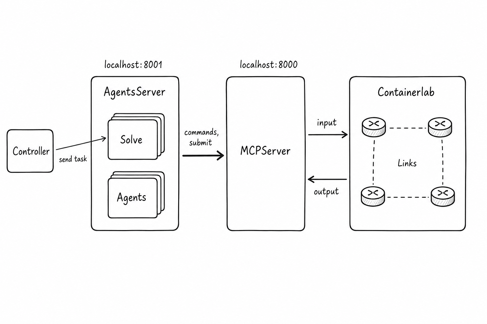

# Agentic evaluation (multi-turn)

NetAgentBench evaluates **multi-turn** agent behavior: an external **agent HTTP harness** (included in this repo as [`agent_harness/`](../agent_harness/) running `dagent.harness_main`) connects to this benchmark’s MCP/tooling surface while the lab runs under **Containerlab**. Other compatible agent services are also allowed as long as they implement the same `/benchmark/solve` contract.

## Architecture

Ports are **configurable**. The CLI default for `--dagent-endpoint` is often `http://localhost:8000`; your agent deployment may expose a different host/port — set `DAGENT_ENDPOINT` accordingly.

1. **Agent side** — Receives tasks, runs solve loops, issues **commands** and **submit** through the MCP interface.
2. **MCP bridge (this benchmark)** — Exposes the tool surface agents use against the emulation.
3. **Containerlab** — Network under test.

This benchmark repository **does not** embed an LLM agent: you must run a compatible agent HTTP service and point **`benchmark run-task --dagent-endpoint`** at it.

## Commands and further reading

- **Paper:** [*NetAgentBench: A State-Centric Benchmark for Evaluating Agentic Network Configuration*](https://arxiv.org/abs/2604.09678) (arXiv:2604.09678).
- **CLI:** [CLI usage](CLI_USAGE.md) — `benchmark run-task`.
- **Studies:** [Research usage](RESEARCH_USAGE.md) — session layout, analysis scripts.
- **Shell helpers:** [Benchmark scripts](BENCHMARK_SCRIPTS.md).

## Citation

See [CITATION.cff](../CITATION.cff) in the repository root for metadata GitHub can surface on the project page.
